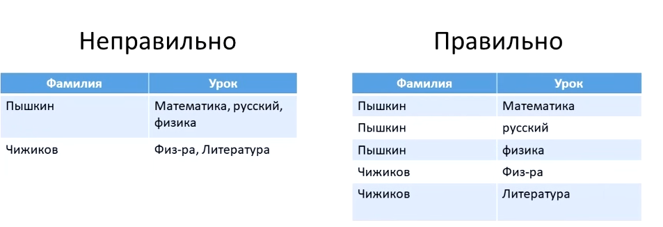
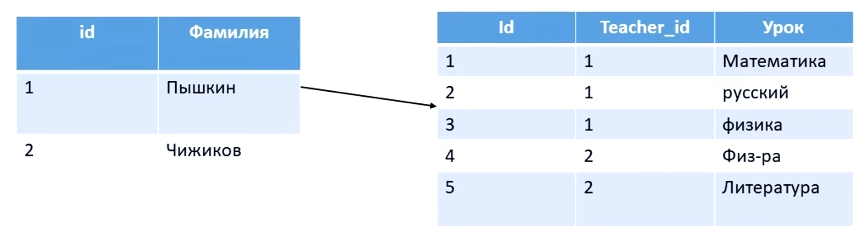
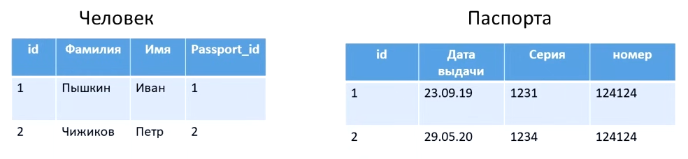
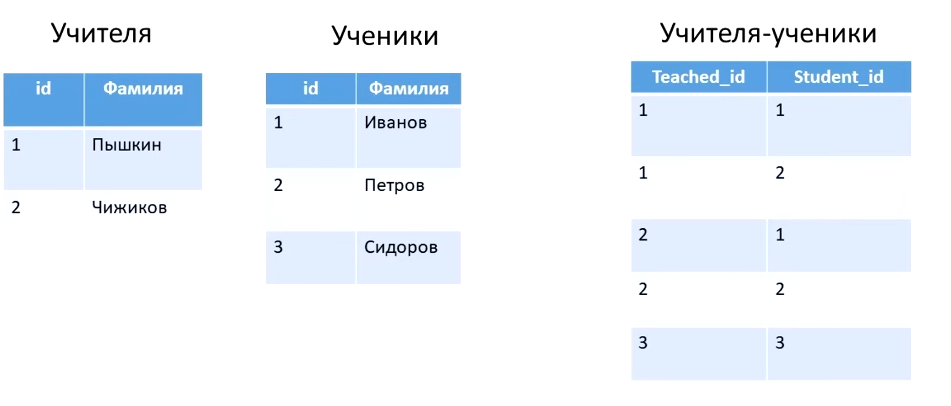

- [Что такое база данных](#db-database)
- [Виды баз данных](#type-db)
- [SQL - Реляционные базы данные](#sql-db)
- [Разбор командной запросов SQL](#command-sql)
- [Материалы](materials)

---

База данных предназначена для того, чтобы хранить какие-то данные и связи между этими данными. Существует два вида базы данных - это SQL (реляционные базы данных) и noSQL (нереляционные базы данных) 

SQL (реляционная базы данных) строго хранят структурированные данные, которые обычно представляют объекты реального мира - сведения о человеке, содержимом корзины в магазине и эти строго структурированные данные хранятся в сгруппированных таблицах. Структура этих таблиц задается на этапе проектирования. Примеры реляционных баз данных - это MySQL, PostgreSQL.

noSQL (нереляционные базы данных) работают по документоориентированные  (или документные СУБД) принципу. Они хранят информацию в виде иерархических структур данных - например как в json формат, то есть данные представлены в виде объекта, еще один вариант хранения таких данных это пары ключ и значения, то есть по какому-то ключу мы сохраняем данные, а потом по этому ключу эти данные извлекаем. Примеры нереляционных баз данных - это MongoDB (json/bson), Redis (ключ - значения), Cassandra (данные хранятся по колонкам)

### SQL - Реляционные базы данные

Реляционная база данных представляет из себя связанных между собой таблиц, и существует определенные нормы по которым эти таблицы должны создаваться - нормальные формы:

1. Нормальная форма - одна ячейка содержит одно значение. 

2. Нормальная форма - каждая запись должна иметь уникальный идентификатор (первичный ключ, id)

Например: Пышкинов может быть 5 человек в базе данных, в него мы присваиваем первичный ключ - id (teacher_id - ссылка на учителя который этот предмет преподает)

Существует несколько связей между таблицами:

1. Связь один ко многим (one-to-many) - один учитель может преподавать несколько предметов. В таблице где указывается many, указывается внешний ключ на таблицу которая указывается one (teacher_id)

2. Связь один к одному (one-to-one) - есть две таблицы одна таблица с данными человеке, а вторая с паспортами. И очевидно, что один человек может иметь лишь один паспорт. По этому в первой таблице человек мы указываем ссылку в виде внешнего ключа на таблицу с паспортом

3. Связь много-ко-многим (many-to-many) - есть две независимые таблицы с учителями и с учениками при этом каждый студент может обучаться у нескольких учителей и каждый учитель может преподавать нескольким студентам. В таком случае создается отдельная таблица - учителя и ученики в котором обозначается какой учитель преподает у какого-то студента и какой студент учится у какого учителя

Если `PostgreSQL` - хранилища данных, то `SQL` - это язык запросов с помощью которых мы можем обращаться к нашей базе данных.

<h3 align='center'>Разбор командной запросов SQL</h3>

- `SELECT` - Взять, выбрать, достать
- `*` или `field` - (достаем) все или определенно поле
- `FROM` - Откуда, из какой таблицы
- `LIMIT` - Сколько (достать), кол-во достающих элементов
- `ORDER BY ${field} DESC` - Сортировка по убыванию, если не писать DESC, то будет по возрастанию
- [`WHERE ${field}`](https://neon.com/postgresql/tutorial/where) - Фильтрация в базе данных ДО агрегации данных (напр. подсчета)
  - `AND` - если оба условия верны
  - `OR` - если одно верно
  - `NOT` - меняет на противоположное значение
  - [`IS (NOT) NULL`](https://neon.com/postgresql/tutorial/is-null) - проверка на (нет) null
  - [`LIKE`](https://www.postgresqltutorial.com/postgresql-tutorial/postgresql-like/) - проверяет слова на соответствие заданному шаблону: 
    - _ (подчёркивание) — заменяет ровно один любой символ.
    - % (процент) - заменяет любую последовательность символов, в том числе пустую. То есть «ноль или больше любых символов».
  - `ILIKE` - если хотим игнорировать регистр
  - [`(NOT) IN`](https://neon.com/postgresql/tutorial/in) - для перечисления, вместо того чтобы писать `name = 'Олег', name = 'Valera'` можно написать name `IN('Олег', 'Валера')` и он возвращает то, что входит в in
  - [`(NOT) BETWEEN`](https://neon.com/postgresql/tutorial/between) - фильтрует данные согласно интервалу `BETWEEN 5 AND 10` означает от 5 до 10, а также работает с датами и временем.
- [`DISTINCT`](https://www.postgresqltutorial.com/postgresql-tutorial/postgresql-select-distinct/) — убирает дубликаты строк, оставляя только уникальные значения;
- [`Агрегатный функции`](https://neon.com/postgresql/aggregate-functions) в  [postgreSQL](https://www.postgresql.org/docs/9.5/functions-aggregate.html) - это «итоговая» функция. Процедура, которая получает на вход много данных и схлопывает их в одно число
  - `COUNT` — считает количество значений в колонке.
  - `SUM` — вычисляет сумму значений.
  - `AVG` — вычисляет среднее значение. 
  - `MAX` — вычисляет максимальное значение.
  - `MIN` — вычисляет минимальное значение.
- [`GROUP BY`]() - объединяет строки с одинаковыми значениями в указанных столбцах в одну общую группу
- [`HAVING`](https://neon.com/postgresql/tutorial/having) - Фильтрация в базе данных ПОСЛЕ агрегации данных (напр. подсчета)

Правильная последовательность написания запросов: `SELECT` => `FROM` => `WHERE` => `GROUP BY` => `HAVING` => `ORDER BY` => `LIMIT`

Порядок выполнения запроса под капотом: `FROM / JOIN` => `WHERE` => `GROUP BY` => `Агрегатные функции (sum, count, avg)` => `HAVING` => `SELECT` => `DISTINCT` => `ORDER BY` => `LIMIT`

<h3 align='center'>Функции в postgreSQL</h3>

- `LENGTH(field)` - возвращает количество символов в указанной строке;
- `UPPER(field)` - переводит в верхний регистр
- `LEFT(field, characterCountToReturn)` - возвращает первые n символов в строке: SELECT LEFT('karpov.courses', 6) => karpov
- `SPLIT_PART(field, separator, ordinalNumberPart)` - разбивает строку на указанный разделитель и возвращает одну из частей => SPLIT_PART('karpov.courses', '.', 2) => courses
- [`CONCAT`](https://neon.com/postgresql/string-functions/concat-function) | Соединяет в одну строку значения из нескольких столбцов.
- [`DATE_PART(part, column)`](https://neon.com/postgresql/date-functions/date_part) - Извлекаем определенную часть, где 
  - `part` - year, month, day, hour; 
  - `column` - указать нужную колонку либо конкретную дату или время.
  Например: `DATE_PART('year', '2022-01-12') => 2022`
- [`DATE_TRUNC(part, column)`](https://neon.com/postgresql/date-functions/date_trunc) -  функция, которая ставит дату на начало нужного периода. То есть она отрезает всё лишнее и оставляет только начало
  - усекли до года → получаем 1 января →  2024-01-01 00:00:00
  - усекли до месяца → получаем 1-е число этого месяца →  2024-05-01 00:00:00
  - усекли до дня → получаем 00:00:00 этого дня → 2024-05-17 00:00:00
  - усекли до часа → получаем начало этого часа. Это нужно чтобы считать данные по месяцам, дням или годам, а не по каждой дате отдельно
- [`TO_CHAR(date, format)`](https://neon.com/postgresql/string-functions/to_char) - для получения наименования дня недели, где format - Dy может возвращать аббревиатуру дня недели 
- [`COALESCE(column, 'some value')`](https://neon.com/postgresql/tutorial/coalesce) - проверка на null:
  -  Если значение = NULL, то заменит на второе значение. 
  -  Если значение != NULL, то вернет первое значение.  
- [`ARRAY_LENGTH(array, integer)`]() - возвращает длину указанного (одного) массива, где первый аргумент - массив, а второй integer - измерения. [Пример](./tasks/03_data-aggregation/array-length.sql)
- [`NOW()`](https://www.postgresqltutorial.com/postgresql-date-functions/postgresql-now/) - получаем текущую дату

Функции также можно комбинировать:  
- `UPPER(LEFT('karpov.courses', 6))` - в начале выполнится LEFT, затем UPPER. 

Функции преобразователи

- `CAST(100 AS VARCHAR)` or `column::VARCHAR` - Из числа в текста
- `CAST('100' AS INTEGER)` or `column::INTEGER` - Из текста в число
- `'2022-12-31'::DATE` - Из текст в дату: 31/12/22 

Математические функции и операторы:
- [Сравнения]() => =, !=, <, >, <=, >=, <>  
- [Арифметические](https://www.postgresql.org/docs/9.3/functions-math.html) - +, -, /, *, %, ^.
- [Логические]() => AND, OR, NOT
- [Округления](https://neon.com/postgresql/math-functions/round) - round(value, number) округление в ближайшую сторону, где первым принимаем число а вторым округлить до скольки знаков после запятой

- [SQL - Formatter](https://codebeautify.org/sqlformatter)
- [Курс по sql](https://lab.karpov.courses/learning/152/module/1762/lesson/17928/53213/257133/)
- [Необходимый форматер для запуска команд по курсу SQL](https://redash.public.karpov.courses/queries/135319/source)